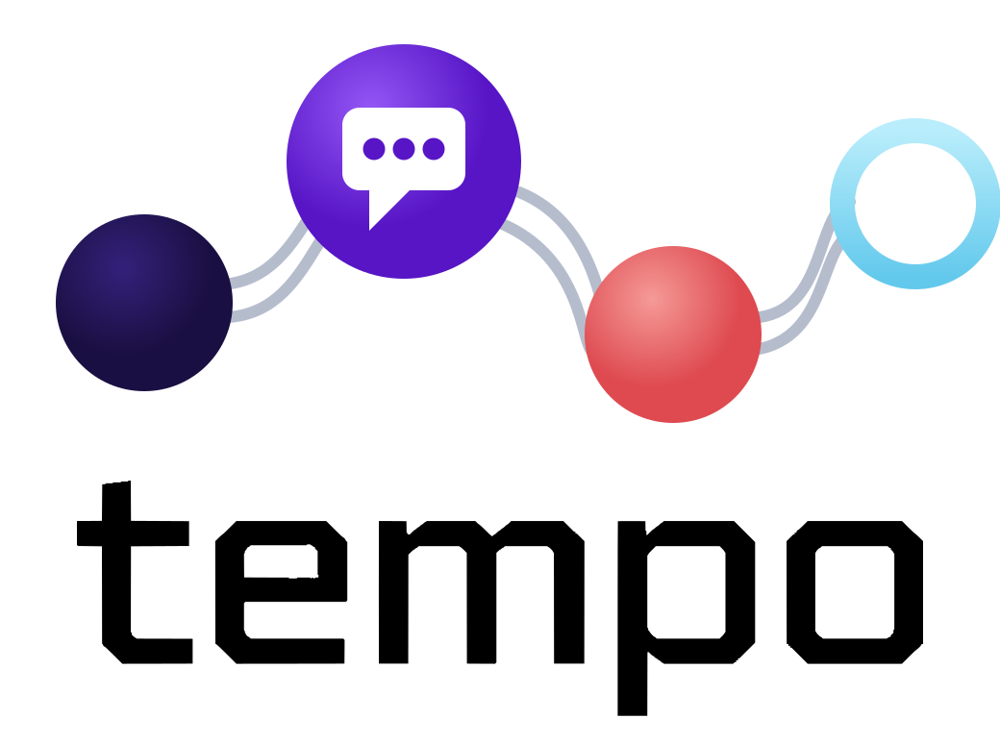

**Tracking, Engagement, Messaging & Participant Outreach**

**[dzweben.github.io/tempo](https://dzweben.github.io/tempo/)**

TEMPO is a server that automates participant communication for long-running research
studies. It reads a study's REDCap or Qualtrics database, sends each participant the visit
reminders, survey invitations, follow-ups and timed prompts they are due, and tracks what
they have completed.

Every participant is on a different schedule, built from their own dates, and whether something is still owed depends on which forms they have finished. TEMPO recomputes all of that from the database on each run, so a corrected date or a new completion takes effect immediately.

It is built for studies that run for months or years, where every participant is on their own
schedule and the messages need to be a conversation. Texts go through the study's own phone
number, so a participant can reply and the exchange sits in one thread a coordinator picks
up. Anyone who texts STOP is silenced everywhere, automatically.

You configure it by writing rules against database fields: fourteen days after the baseline
visit, while that form is still incomplete. Completing one survey can be what makes the next
message due, which is enough to run a protocol lasting years.

It runs the participant communication for NIH-funded longitudinal research, covering several
hundred participants.

This repository is published as a record of how that system works. It is not
software you can install, and there is no quickstart here, because there is no
honest version of one to write. [Running this for a real
study](#running-this-for-a-real-study) explains why.

---

## What it is for

Scheduling in a longitudinal study is driven by dates that are already in the survey
database. A participant consents on the 4th, so their baseline questionnaire opens on the
11th. They attend a visit on the 3rd, so the between-visit survey goes out a week later, and
again the week after unless they have already completed it. Someone in the
momentary-assessment arm gets twenty-five prompts over ten days, each at a specific minute.

Tracking is the other half of the same data. The completion flags that decide whether to send
a reminder also tell you how far through their sequence each participant is, which
instruments are outstanding, and where a wave stands overall. TEMPO computes the schedule and
reports the state from one pass over the same records.

## What it handles

- **Reminders and sequences hung off each participant's own dates.** Follow-ups
  stop queueing the moment the form is marked complete, so people who have
  already answered stop hearing from you.
- **Momentary assessment (EMA/ESM).** A fixed set of weekday and clock-time
  slots, anchored to each participant's start date, delivered on the minute. If
  a prompt misses its window it gets logged as skipped.
- **Recurring cycles.** Monthly or weekly waves computed from one anchor date
  each, with their own invite and follow-up cadence.
- **Visit, at-home and compensation notices,** each with their own timing,
  conditions and expiry.
- **Per-participant survey links,** fetched from the survey platform at send
  time, so a message whose link did not resolve is held back and a broken link never reaches anyone.
- **A dashboard and a nightly reconciliation.** What is scheduled, what went
  out, how far each participant has got through their own sequence, and an
  overnight check of planned against actual so a missed message turns up the
  next morning.

## How it works

Every run does the same five things, start to finish.

1. **Pull.** Export the study over the REDCap or Qualtrics API, one call per
   event, and stitch it together on `record_id` so you end up with a single row
   per participant holding their dates, the completion flag on each instrument,
   and their contact details.
2. **Expand.** Run every rule against that row. Fill in the `[event][field]`
   references with that person's values, fetch the survey URLs the message
   needs, do the date arithmetic, and you get one dated line per participant for
   each time the message is owed.
3. **Select.** Narrow that to the lines falling in this run's window, and check
   each one's condition against the completion flags as they stand right now.
   Drop anyone who opted out, anything inside quiet hours, anything whose link
   did not resolve, and anything the ledger says already went.
4. **Send.** Claim the line so nothing else can take it, render the body with
   that person's details and survey URL in it, and hand it to the messaging
   provider or to SMTP.
5. **Record.** Write the send to the ledger. That line is what every later run
   checks against, which is how the same message never goes out twice.

### The grid

A rule produces the date. Fourteen days after the baseline visit, repeating weekly, up to three times, while the form is still incomplete. Each run evaluates those rules
against the current roster and produces one row per participant for each time a message is
due, with the timestamp, the destination and the message body already filled in. Those rows
are the whole schedule for the study.

The grid is thrown away and rebuilt on every run. The only thing kept between runs is the
ledger of what has been sent. That is what makes fixing things cheap: if a coordinator
corrects a wrong visit date in REDCap, every message anchored to that date is right on the
next run.

### What counts as a trigger

A rule has two parts and both point at the survey platform. The condition that decides
whether a message is owed is a field reference, written `[event][field]`, and so is the date
it counts from. There is no list of message types in the code and no special case for
momentary assessment or for visit reminders. A condition is a field that is not marked
complete. An anchor is a date field on some event.

Because of that, schedules chain without anyone sequencing them. Completing an instrument
changes a field that another rule is watching. Record a visit and its questionnaires come
due. Complete those and their reminders stop, and the visit date becomes the anchor for the
next phase. Nobody writes that ordering down. It comes out of the field references, which is
why a three-year protocol that branches on what participants do is still a flat list of
rules.

### The clock

Nothing runs continuously. Cron invokes the pipeline, and the only requirement is that it
runs often enough that no slot falls between runs. A reminder due at 5pm is covered by a run
at 5pm. A prompt that has to arrive at 8:10 needs runs that overlap that slot, because cron
will not fire at exactly 8:10:00. The run picks the slot up early and waits in process until
the scheduled second. In practice prompts land two to four seconds after the second they were
scheduled for, and that figure is written to the ledger for every message, so drift is
visible.

You can run it as often as you want. Each run rebuilds the grid from a fresh export and checks
the ledger before sending, so an extra run finds nothing to do and exits. How often you run it
depends on how precise the timing needs to be.

## Not sending the same thing twice

Three separate checks have to fail before the same message goes out twice. Duplicates matter
more here than in most software: a repeat text, or one that arrives at 3am, is a protocol
deviation the study has to report, and many participants are minors.

- **The ledger.** Every send gets appended to a log keyed by participant,
  message, time, channel and recipient. Any later run checks that log before it
  does anything, so a retry, an overlapping schedule or a replayed job finds the
  message already accounted for and stops.
- **Claiming.** A run claims a slot before it transmits. If two runs reach the
  same slot at once, only one of them gets the claim and only that one sends.
- **Asking the provider.** Before anything goes out late or gets recovered, the
  system asks the messaging provider whether that message already reached that
  person. That covers the one case the ledger cannot: the message went out but
  the record of it was lost.

There are other guards around it. Nothing transmits outside the daily window. The
opt-out list is checked when the queue is built and checked again right before
sending, because somebody can opt out in between. A cap limits how much any one
run can send, so a bad rule cannot blast the whole roster. Dry-run is the
default, and there is a switch that puts everything back into dry-run without
waiting on a deploy.

## What a system like this needs

| | |
|---|---|
| **Survey platform** | A record export, date fields, per-form completion flags, and a per-participant survey link. The build here uses REDCap. |
| **SMS provider** | A send endpoint, and ideally a message-history endpoint so you can check whether something already arrived. The build here uses OpenPhone. |
| **Email** | SMTP credentials, or any HTTP send API. The build here uses Gmail SMTP. |
| **A scheduler** | Anything that can call a URL on a schedule: cron, a platform cron trigger, a CI timer. |
| **Somewhere to put two things** | The rebuilt grid, and the append-only record of what was sent. The reference implementation keeps both as JSON in an access-controlled store; object storage, a database or an encrypted volume all work. |

The survey platform stays the source of truth the whole way through. TEMPO holds
as little as it can about a participant, which comes down to a record identifier
and a way to contact them. [SECURITY.md](SECURITY.md) covers what that means in
practice.

The dashboard is Next.js, React, TypeScript and Tailwind. The pipeline and the
senders are Node scripts.

## Running this for a real study

Realistically, you cannot take this repository and run it for your own study
without me.

Sending to participants means holding their contact information, and it means
holding API credentials for the survey platform their data lives in. Both of
those are governed by your protocol, not by a licence file. In practice I would
need to be named on your IRB to have the access required to set it up and keep it
running.

So this is a description of a system that works, published so the design is
citable and inspectable. If you are running a longitudinal study with timing
requirements like these and want to talk about it, open an issue on this
repository. If you would rather build your own from the description above,
everything you need to know about the design is in this file and on
[the site](https://dzweben.github.io/tempo/).

## What is in this repository

Source files only. Study-specific identifiers were replaced with placeholders,
the schedule ships as a synthetic example, and no
participant data or credentials have ever been committed here. The dashboard
screenshots on the site are generated from made-up records. The reference CI
workflows under `examples/` come from a production deployment and are meant to be
read and adapted, not run as-is.

## License

See [LICENSE](LICENSE).

## Citation

Zweben, D. (2026). *TEMPO (Tracking, Engagement, Messaging & Participant Outreach):
automated survey scheduling and participant messaging for longitudinal studies*
[Computer software]. Zenodo. https://doi.org/10.5281/zenodo.22925367

That DOI always resolves to the newest version. To cite the exact release you
read, use the version DOI instead.
